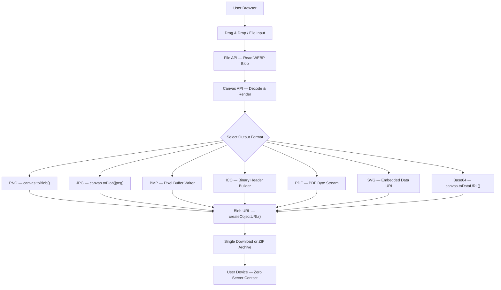

# PixelForge — WEBP Converter Suite

### Enterprise-Grade, Privacy-First Image Conversion. 100% In-Browser. Zero Backend.

[](https://opensource.org/licenses/MIT)
[](https://github.com/SPManchester/webp/pulls)
[](https://developer.mozilla.org/en-US/docs/Web/HTML)
[](https://developer.mozilla.org/en-US/docs/Web/JavaScript)
[](https://developer.mozilla.org/en-US/docs/Web/CSS)
[](https://pages.github.com/)

---

<p align="center">
  <strong>Built with ❤️ by <a href="https://www.spmanchester.com" target="_blank">SPManchester Private Limited</a></strong>
</p>

---

## 📑 Table of Contents

- [Project Overview](#-project-overview)
- [Architecture Diagram](#-architecture-diagram)
- [Key Features](#-key-features)
- [Converter Tools](#-converter-tools)
- [Tech Stack](#-tech-stack)
- [Getting Started](#-getting-started)
  - [Prerequisites](#prerequisites)
  - [Clone the Repository](#clone-the-repository)
  - [Open Locally](#open-locally)
  - [Deploy to GitHub Pages](#deploy-to-github-pages)
- [Project Structure](#-project-structure)
- [Browser Compatibility](#-browser-compatibility)
- [Roadmap](#-roadmap)
- [Contributing](#-contributing)
- [Security](#-security)
- [About SPManchester Private Limited](#-about-spmanchester-private-limited)
- [License](#-license)

---

## 🚀 Project Overview

**PixelForge — WEBP Converter Suite** is a fully client-side, open-source image conversion toolkit built entirely with pure HTML5, CSS3, and Vanilla JavaScript. It provides seven purpose-built tools that convert WEBP images into the most widely-used formats — PNG, JPG, BMP, ICO, PDF, SVG, and Base64 — directly inside the user's browser, without any server uploads, backend infrastructure, or third-party dependencies.

### The Problem It Solves

Modern web workflows frequently produce WEBP images for performance reasons, but downstream tools — legacy CMS platforms, email clients, print pipelines, icon editors, and embedded systems — often require images in traditional formats. Existing online converters impose file-size limits, inject watermarks, upload files to remote servers (a significant privacy risk), and frequently lock essential features behind paywalls.

PixelForge eliminates all of these friction points. By leveraging the browser's native **Canvas API** and **File API**, every conversion happens locally on the user's machine — files never leave the device.

### Why Enterprise-Grade?

- **Zero data exposure** — no server round-trips, no telemetry, no third-party SDKs
- **Batch processing** — convert hundreds of files in a single session
- **Deterministic output** — the same input always produces the same output, with no server-side variability
- **Offline capable** — works without an internet connection once the page is loaded
- **Freely auditable** — the entire codebase is open-source under the MIT license

---

## 🏗️ Architecture Diagram



---

## ✨ Key Features

- **🔒 100% Privacy-First** — All conversions run entirely in the browser using native Web APIs. No files are ever uploaded to any server.
- **⚡ Zero Dependencies** — Pure HTML5, CSS3, and Vanilla JavaScript. No npm, no build tools, no frameworks — open and deploy in seconds.
- **📦 Batch Conversion** — Select or drag multiple WEBP files simultaneously and convert them all in one operation.
- **🗂️ ZIP Download** — Download all converted files as a single ZIP archive with one click, powered by a lightweight in-browser ZIP writer.
- **↔️ Resize on Export** — Optionally specify target width and height before conversion; the Canvas API handles high-quality resizing.
- **🖱️ Drag & Drop Interface** — Intuitive drag-and-drop upload zones with live preview thumbnails for each queued file.
- **🚫 No Watermarks** — Output files are clean and unmodified beyond the requested format conversion.
- **📱 Mobile-Friendly** — Fully responsive UI designed to work seamlessly on smartphones, tablets, and desktops.

---

## 🛠️ Converter Tools

| Tool | Output Format | Live Demo | Description |
|------|--------------|-----------|-------------|
| `webp-to-png` | PNG | [Demo](#) | Lossless conversion with full alpha-channel (transparency) preservation |
| `webp-to-jpg` | JPG / JPEG | [Demo](#) | Lossy compression with configurable quality slider (0–100) |
| `webp-to-bmp` | BMP | [Demo](#) | Uncompressed bitmap output for legacy software and print workflows |
| `webp-to-ico` | ICO | [Demo](#) | Multi-resolution ICO file generation for favicons and Windows icons |
| `webp-to-pdf` | PDF | [Demo](#) | Single-page PDF embedding for document pipelines and archiving |
| `webp-to-svg` | SVG | [Demo](#) | SVG wrapper with embedded raster data for scalable vector workflows |
| `webp-to-base64` | Base64 | [Demo](#) | Inline data URI string output for embedding images directly in HTML or CSS |

> **Note:** Live Demo links will be activated upon deployment to GitHub Pages.

---

## 🧰 Tech Stack

| Technology | Purpose | Why Chosen |
|------------|---------|------------|
| **HTML5** | Markup, File API, Canvas element | Native browser APIs eliminate all external dependencies |
| **CSS3** | Responsive layout, animations, theming | Zero-runtime-cost styling with modern Flexbox and Grid |
| **Vanilla JavaScript** | Conversion logic, ZIP generation, DOM control | Maximum portability; runs in any modern browser without a build step |
| **Canvas API** | Image decoding, pixel manipulation, re-encoding | The browser's built-in GPU-accelerated image processing surface |
| **File API / Blob API** | Reading input files, creating downloadable output | Standard W3C APIs with universal browser support |
| **GitHub Pages** | Static hosting and CDN delivery | Free, reliable, zero-config deployment from the repository |

---

## 🏁 Getting Started

### Prerequisites

- A modern web browser (Chrome 90+, Firefox 88+, Safari 14+, or Edge 90+)
- [Git](https://git-scm.com/) installed on your machine
- No Node.js, no package manager, no build tool required

### Clone the Repository

```bash
git clone https://github.com/SPManchester/webp.git
cd webp
```

### Open Locally

No local server is required for basic usage. Simply open any tool's `index.html` directly in your browser:

```bash
# On Windows
start webp-to-png/index.html

# On macOS
open webp-to-png/index.html

# On Linux
xdg-open webp-to-png/index.html
```

For a consistent development experience across all tools, you may optionally serve the project with any static file server:

```bash
# Using Python (built-in)
python -m http.server 8080

# Using Node.js http-server (if available)
npx http-server . -p 8080
```

Then navigate to `http://localhost:8080` in your browser.

### Deploy to GitHub Pages

1. **Fork or push** this repository to your GitHub account.
2. Navigate to your repository on GitHub.
3. Click **Settings** → **Pages** (in the left sidebar).
4. Under **Source**, select **Deploy from a branch**.
5. Set the branch to `main` (or `master`) and the folder to `/ (root)`.
6. Click **Save**.
7. GitHub will provide a URL in the format `https://<your-username>.github.io/webp/` within a few minutes.
8. Each tool will be accessible at `https://<your-username>.github.io/webp/<tool-name>/`.

---

## 📁 Project Structure

```
webp/
├── README.md                  # This file
├── CONTRIBUTING.md            # Contribution guidelines
├── SECURITY.md                # Security policy and vulnerability reporting
├── LICENSE                    # MIT License
│
├── webp-to-png/
│   └── index.html             # WEBP → PNG converter
│
├── webp-to-jpg/
│   └── index.html             # WEBP → JPG/JPEG converter
│
├── webp-to-bmp/
│   └── index.html             # WEBP → BMP converter
│
├── webp-to-ico/
│   └── index.html             # WEBP → ICO (favicon) converter
│
├── webp-to-pdf/
│   └── index.html             # WEBP → PDF converter
│
├── webp-to-svg/
│   └── index.html             # WEBP → SVG converter
│
└── webp-to-base64/
    └── index.html             # WEBP → Base64 Data URI converter
```

---

## 🌐 Browser Compatibility

All seven tools rely exclusively on stable, well-supported Web APIs. The table below reflects tested compatibility:

| Browser | Minimum Version | WEBP Decode | Canvas Export | ZIP Download | Notes |
|---------|----------------|-------------|---------------|--------------|-------|
| **Google Chrome** | 90+ | ✅ Native | ✅ Full | ✅ Full | Recommended for best performance |
| **Mozilla Firefox** | 88+ | ✅ Native | ✅ Full | ✅ Full | Full feature parity |
| **Apple Safari** | 14+ | ✅ Native | ✅ Full | ✅ Full | iOS Safari 14+ also supported |
| **Microsoft Edge** | 90+ | ✅ Native | ✅ Full | ✅ Full | Chromium-based Edge fully supported |

> Legacy browsers (Internet Explorer, pre-Chromium Edge) are **not** supported, as they lack native WEBP decoding and modern Canvas/Blob APIs.

---

## 🗺️ Roadmap

The following enhancements are planned for future releases:

1. **Progressive Web App (PWA) Support** — Add a Service Worker and Web App Manifest so PixelForge can be installed as a standalone offline app on any device.
2. **Advanced Export Controls** — Expose per-format quality, DPI, colour-space, and metadata-stripping options through an expandable settings panel.
3. **Reverse Conversion Suite** — Extend PixelForge to accept PNG, JPG, BMP, and other formats as inputs and convert them *to* WEBP, completing a full bidirectional image utility suite.

---

## 🤝 Contributing

Contributions are warmly welcomed from the community. Whether you are fixing a bug, improving the UI, adding a new output format, or enhancing documentation, please read our [**CONTRIBUTING.md**](CONTRIBUTING.md) first to understand the workflow, coding standards, and pull request process.

```text
1. Fork the repository
2. Create your feature branch:  git checkout -b feature/your-feature-name
3. Commit your changes:         git commit -m "feat: add your feature"
4. Push to the branch:          git push origin feature/your-feature-name
5. Open a Pull Request
```

All contributors are expected to follow the project's Code of Conduct as outlined in [CONTRIBUTING.md](CONTRIBUTING.md).

---

## 🔐 Security

We take the security of PixelForge and the privacy of its users seriously. Because all processing is client-side, the attack surface is intentionally minimal — there is no server, no database, and no authentication layer.

If you discover a security vulnerability or a potential privacy concern within this project, please **do not open a public GitHub issue**. Instead, refer to our [**SECURITY.md**](SECURITY.md) for responsible disclosure guidelines and contact information.

---

## 🏢 About SPManchester Private Limited

**SPManchester Private Limited** is a technology company dedicated to building open, accessible, and privacy-first digital tools for developers, designers, and enterprises worldwide. We believe that powerful software should not come at the cost of user privacy or vendor lock-in, and we back that belief by open-sourcing the tools we build.

🌐 Website: [www.spmanchester.com](https://www.spmanchester.com)
📧 Support: [info@spmanchester.com](mailto:info@spmanchester.com)

---

## 📄 License

This project is licensed under the **MIT License**.

```
MIT License

Copyright (c) 2026 SPManchester Private Limited
Author: Sayed Mudassar Akbar

Permission is hereby granted, free of charge, to any person obtaining a copy
of this software and associated documentation files (the "Software"), to deal
in the Software without restriction, including without limitation the rights
to use, copy, modify, merge, publish, distribute, sublicense, and/or sell
copies of the Software, and to permit persons to whom the Software is
furnished to do so, subject to the following conditions:

The above copyright notice and this permission notice shall be included in all
copies or substantial portions of the Software.

THE SOFTWARE IS PROVIDED "AS IS", WITHOUT WARRANTY OF ANY KIND, EXPRESS OR
IMPLIED, INCLUDING BUT NOT LIMITED TO THE WARRANTIES OF MERCHANTABILITY,
FITNESS FOR A PARTICULAR PURPOSE AND NONINFRINGEMENT. IN NO EVENT SHALL THE
AUTHORS OR COPYRIGHT HOLDERS BE LIABLE FOR ANY CLAIM, DAMAGES OR OTHER
LIABILITY, WHETHER IN AN ACTION OF CONTRACT, TORT OR OTHERWISE, ARISING FROM,
OUT OF OR IN CONNECTION WITH THE SOFTWARE OR THE USE OR OTHER DEALINGS IN THE
SOFTWARE.
```

See the [LICENSE](LICENSE) file for the full text.

---

<p align="center">
  Made with ❤️ by <a href="https://www.spmanchester.com">SPManchester Private Limited</a> | <a href="https://www.spmanchester.com">www.spmanchester.com</a>
</p>
